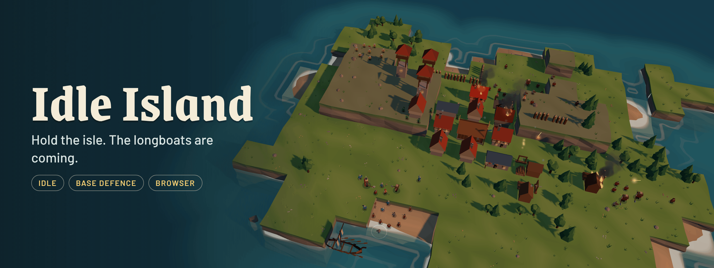
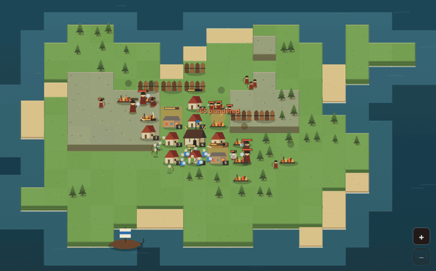
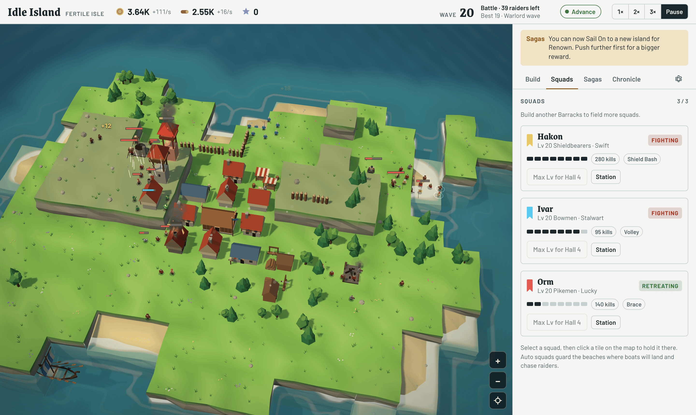
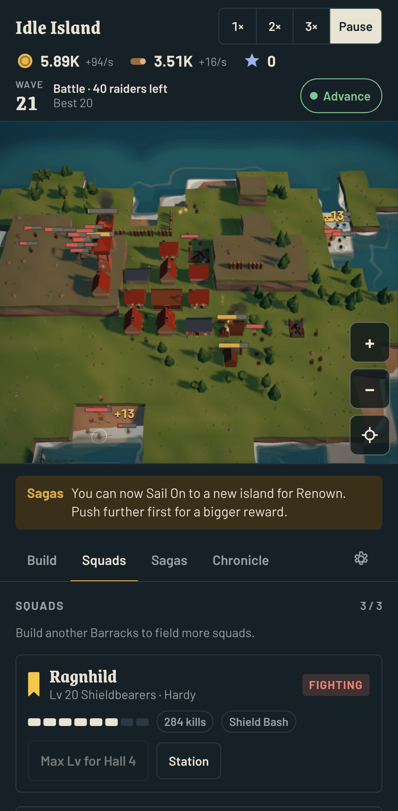

<p align="center">
  <a href="https://gorzaweba.github.io/Idle-Island/">
    
  </a>
</p>

<p align="center">
  <a href="https://gorzaweba.github.io/Idle-Island/"></a>
  <a href="https://gorzaweba.github.io/Idle-Island/"></a>
  
  
  
</p>

<h3 align="center">Hold the isle. The longboats are coming.</h3>

<p align="center">
  An idle base-defence game for the browser. Settle a small, procedurally generated island, build it up,<br>
  and keep it standing while raiders row in from every side. Battles fight themselves;<br>
  you decide what to build, where to put it, how to train your squads and when to sail on.
</p>

<p align="center">
  <a href="https://gorzaweba.github.io/Idle-Island/"><b>▶&nbsp; Play Idle Island on GitHub Pages</b></a>
  &nbsp;·&nbsp;
  <a href="GAME_DESIGN.md">Read the game design</a>
</p>

<p align="center">
  
</p>

---

## ✨ Features

- 🏝️ **A new island every run.** Beaches, cliffs, highland and forest are generated from a seed, and each island has a trait such as *Fertile*, *Fogbound* or *Many Shores*.
- ⛵ **Raiders you can see coming.** Longboats appear on the horizon during the countdown. Markers at the screen edge show where each one will land and how many raiders it carries.
- 🛡️ **Squads with names and personalities.** Each commander has a trait. Promote your militia to Shieldbearers, Bowmen or Pikemen, each with its own automatic ability.
- 🔥 **Houses that burn.** Raiders torch whatever they reach. Ruins stop producing, and a burning cottage costs you some of your gold.
- 🌊 **The sea is a weapon.** Shield bashes and brute swings knock units back, and anyone pushed into the water drowns.
- 🏗️ **Placement matters.** Lumber camps want forest, markets want cottages around them, towers want high ground, and palisades funnel raiders off the beaches.
- 💤 **Real idle play.** Income keeps flowing, waves run on their own, and progress continues while you're away (up to 8 hours).
- 📜 **Prestige.** Reach wave 10, then sail to a fresh island for Renown and spend it on permanent Sagas.
- 📱 **Phone friendly.** The layout stacks on small screens, and the game saves in your browser.

## 🧭 How a run goes

1. **Gold** trickles in from Cottages and the Great Hall; **timber** from Lumber Camps next to trees.
2. A countdown runs between waves while the longboats close in. Use **Call now** to bring them in early for bonus gold.
3. Your squads move to the beaches where the boats will land, fight, fall back to a cottage to refill, then return.
   Click a squad and then a tile to make it hold a hill or a chokepoint.
4. Spend on more buildings, Great Hall upgrades and squad training.
5. If the Hall falls, you drop back a wave and replay it until you switch **Advance** back on.
6. From wave 10 you can **Sail On** to a new island. The best wave you reached becomes Renown, which you spend on Sagas.

## ⚔️ Your squads

| Class | Strengths | Weaknesses | Ability (automatic) |
| :-- | :-- | :-- | :-- |
| 🪖 **Militia** | Cheap. Every squad starts here | Weak at everything | None. Promote them for 50 gold |
| 🛡️ **Shieldbearers** | Sturdy; take only 40% damage from arrows | Average damage | **Shield Bash**: a heavy hit that knocks nearby raiders back, maybe into the sea |
| 🏹 **Bowmen** | 3.5 tiles of range, +1 on highland | Fragile up close | **Volley**: an arrow storm on the thickest crowd of raiders |
| 🔱 **Pikemen** | Long reach; double damage to Brutes, Berserkers and Warlords; can't be knocked back | Take extra damage from arrows; slow | **Brace**: the first strike on each new foe deals double |

Commander traits: *Stalwart*, *Fierce*, *Swift*, *Keen-eyed*, *Hardy*, *Lucky*.

## 🪓 The raiders

| Raider | From wave | Notes |
| :-- | :-: | :-- |
| Raider | 1 | Axe and torch. Heads for the nearest building and fights anyone in the way |
| Skirmisher | 3 | Shoots your squads, then sets roofs alight from range |
| Shieldman | 6 | Takes only 35% damage from arrows |
| Brute | 9 | Huge and slow. Its swings send defenders flying |
| Berserker | 13 | Fast, hits hard, goes down easily |
| 👑 Warlord | every 10th | Boss with a big health pool. Nearby raiders hit harder. Pays out gold and timber |

## 🏘️ Buildings

| Building | Unlocks at Hall | What it does |
| :-- | :-: | :-- |
| **Great Hall** | start | Produces gold, has a few archers and refills squads. Its level raises building limits and max levels. **If it falls, you lose the wave** |
| **Cottage** | 1 | Your main source of gold, and a place for squads to refill |
| **Lumber Camp** | 1 | Timber. Each adjacent tree adds more |
| **Barracks** | 1 | +1 squad slot. Each level adds health and damage to every squad |
| **Watchtower** | 2 | Shoots raiders on its own, with extra range on highland |
| **Palisade** | 2 | A wall raiders must break or walk around. Your squads pass through it |
| **Market** | 3 | +20% gold per level to every adjacent Cottage and to the Hall |

## 🖼️ Screenshots

<table>
  <tr>
    <td width="70%"></td>
    <td></td>
  </tr>
  <tr>
    <td align="center"><sub>Desktop, light theme</sub></td>
    <td align="center"><sub>Phone, dark theme</sub></td>
  </tr>
</table>

## ⌨️ Controls

| Input | Action |
| :-- | :-- |
| Click a building | Inspect, upgrade or demolish it |
| Pick in **Build**, then click a tile | Place a building (palisades stay in build mode) |
| Click a squad, then a tile | Hold that position. **Back to auto** releases it |
| <kbd>Esc</kbd> or right-click | Cancel |
| <kbd>Space</kbd> | Pause |
| <kbd>1</kbd> <kbd>2</kbd> <kbd>3</kbd> | Game speed |

## 🛠️ Run it locally

Clone the repository and open `index.html`. There's no build step, no server and no dependencies.

```sh
git clone https://github.com/GorzaWebA/Idle-Island.git
cd Idle-Island
open index.html          # or xdg-open / start, or just double-click it
```

To get a single self-contained file you can pass around, run `node tools/build.js`. It writes `dist/idle-island.html`.

## 🚀 Deploying to GitHub Pages

The game is all static files, with `index.html` at the repository root, so GitHub Pages can serve it either way.
Choose under **Settings → Pages → Deploy from a branch**:

- **From `gh-pages` (recommended).** Select `gh-pages` and `/ (root)`, and publish with:

  ```sh
  tools/deploy-pages.sh
  ```

  The script copies only what the game needs (`index.html`, `css/`, `js/` and the link-preview image) into `gh-pages`, then commits and pushes. The live site changes only when you deploy.
- **Straight from a code branch.** Select that branch and `/ (root)`. Every push goes live within a minute or two.

## 🗂️ Code layout

| File | What it does |
| :-- | :-- |
| `js/util.js` | Seeded RNG, value noise, number formatting |
| `js/data.js` | All game data and balance formulas: buildings, classes, raiders, waves, Sagas |
| `js/island.js` | Procedural island generator (beaches, highland, forest, Hall site) |
| `js/state.js` | Persistent state, derived stats, economy actions, save/load, offline progress |
| `js/sim.js` | Fixed-step battle simulation: boats, flow-field raider pathing, squad AI, combat |
| `js/render.js` | Canvas renderer (3/4 oblique view) |
| `js/ui.js` | Header, tabbed panel, map input |
| `js/main.js` | Boot, main loop, autosave |

The simulation (`util`, `data`, `island`, `state`, `sim`) never touches the DOM, so it also runs headless in Node.

## 🧪 Tools

```sh
node tools/balance.js 60 3     # a greedy bot plays 3 islands for 60 game-minutes each and reports pacing
node tools/balance.js 45 2 3   # the same, with every Saga at level 3
node tools/smoke.js            # loads the game in headless Chromium, plays a little, saves screenshots
node tools/screenshots.js      # regenerates the images in assets/ (needs ffmpeg for the GIF)
node tools/build.js            # bundles everything into dist/idle-island.html
tools/deploy-pages.sh          # publishes the game to the gh-pages branch
```

`smoke.js` and `screenshots.js` need Playwright with Chromium.

## 🙏 Inspiration

The core mechanics are inspired by **Bad North**: longboats landing on small islands, houses that burn,
squads that refill in cottages, and units knocked into the sea. They're rebuilt here as an idle game with
original art and code. [GAME_DESIGN.md](GAME_DESIGN.md) maps each borrowed mechanic to its idle version
and explains the balance targets.

<p align="center">
  <a href="https://gorzaweba.github.io/Idle-Island/"></a>
</p>

